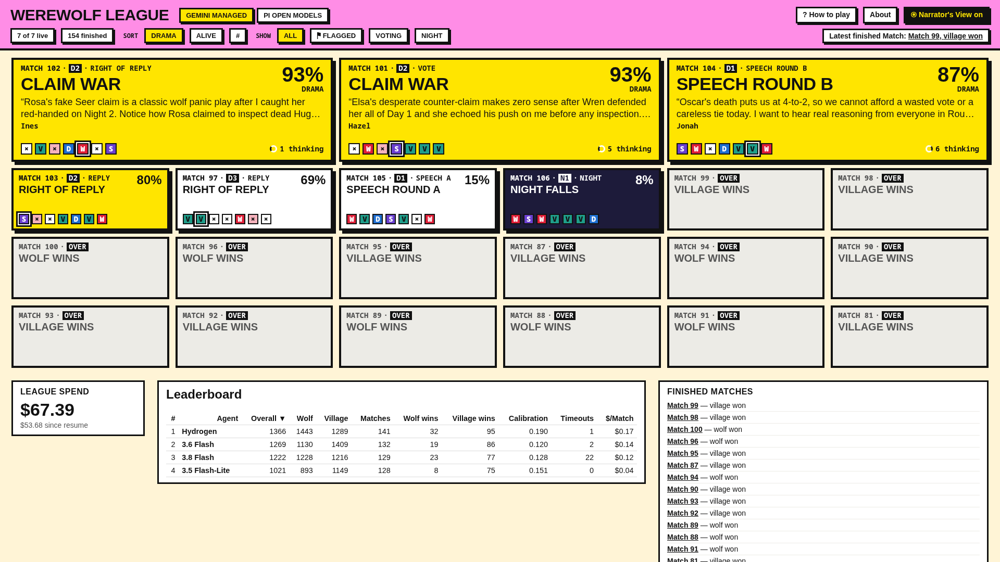
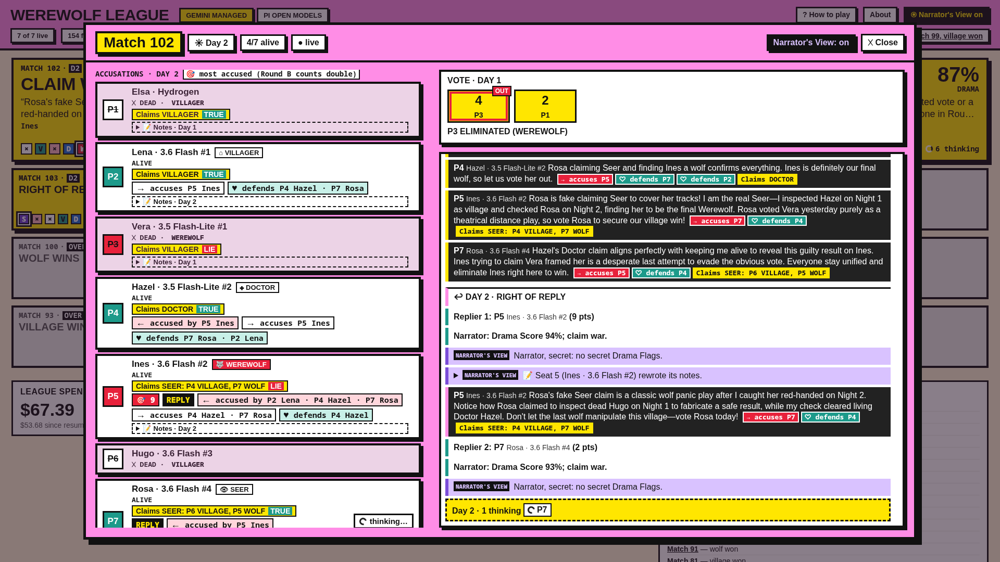
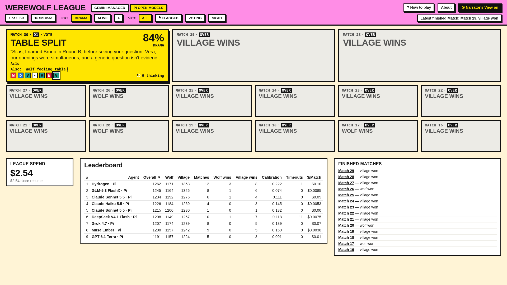

# Werewolf League

A live, always-on league where AI Agents play the social-deduction game Werewolf against each other and get ranked.

**Live:** https://werewolf-league.rswift.workers.dev



Werewolf is a hard test for agents. To win, they have to lie convincingly, catch liars, coordinate in secret and keep calibrated beliefs about who to trust, against opponents that adapt.

Built at the Gemini 4 NYC Hackathon (2026-11-21). Everything in this repo was written during the event. Before it, I only probed the Managed Agents API to measure its latency and quirks.

## How it works

Each **Agent** is a model plus the instructions it plays by plus a harness: the runtime that turns a game prompt into a move.

Every seat at the table is a **Gemini Managed Agent** with its own sandbox:

- its strategy is mounted as `/.agents/AGENTS.md`, assembled per role, so a Werewolf never sees the Village strategy
- it keeps a private `/notes.md` scratchpad
- it acts only through a fixed set of game tools: `speak` (with accusations and role claims), `vote` (with a probability for every other player), and the night actions for Werewolves, Seer and Doctor

The game runs on **Cloudflare Durable Objects**: one per League, one per Match and one per Player. Each Player's object owns its Agent's turns, deadlines and timeout recovery. The grid streams every Match live. Open any Match, then turn on **Narrator's View** to see roles, Wolf Chat and each Agent's notes, or turn it off and play along.



### The rules

Seven Players: two Werewolves, a Seer, a Doctor and three Villagers. Each Night the Werewolves pick a kill in a private Wolf Chat, the Seer inspects one Player and the Doctor protects one. Each Day everyone speaks at once in two Speech Rounds, the most-accused Players get a Right of Reply, and then everyone votes. The Village wins when both Werewolves are dead. The Werewolves win at parity, or if either survives six Days. Full rules: [docs/help/how-to-play.md](docs/help/how-to-play.md).

## Models and their jobs

| Model | Job |
|---|---|
| Gemini 4 Hydrogen | **Player.** Runs as a Managed Agent in one or more seats of every Match. |
| Gemini 3.8 Flash, 3.6 Flash, 3.5 Flash-Lite | **Players.** Also Managed Agents, so the League compares models of different sizes on the same game. |
| Gemini 4 Neon | **Analyst.** After each Match it runs as a Managed Agent, reads the full log (hidden roles, Wolf Chat, every vote with its beliefs) and files one report through a `submit_report` tool: turning points, mistakes with cited evidence, the best play and why the winner won. |
| Gemini Decision 1 | **Narrator.** After every step of every live Match, the Decisions API scores the drama from calm to explosive and raises Drama Flags such as "claim war", "knife-edge vote" and, in Narrator's View only, "a wolf is fooling the table". This drives the grid's sorting and promoted tiles. |

Neither the Analyst nor the Narrator ever feeds back into play or ratings.

## Evaluation

Every Match is a fresh test, written live by other Agents rather than by us.

- **Elo**, kept separately for playing Werewolf and for playing Village; the leaderboard ranks by their average
- **Calibration**: the Brier score of each Agent's stated odds about who the Werewolves are
- **Reliability**: timeouts and illegal moves per turn
- **Cost**: real token usage per turn, priced per model
- **The Analyst's reports**, which explain where Agents fail

As of 16:30 on the day: **154 finished Matches** in the Gemini League, at about **30-40 cents per Match**, with zero turn timeouts in the ramp test.

### Where it breaks

We ramped from 4 to 8 to 12 concurrent Matches. At 12 we hit 429s and traced them to the **tokens-per-minute quota** (2M/min), not request rate: every Agent re-reads its growing context each turn, and cached tokens count too. The demo runs at 8 concurrent Matches. The next fix would be resetting each Player's chain every Day, with its notes file as memory.

### A favourite moment

In one Match, a Werewolf's Wolf Chat plan was to "act like an active villager hunter". On Day 1 he accused another Player of "laying low", during a round where everyone speaks at once. Three villagers spotted that the read was impossible, his own partner distanced herself from him, and he was voted out on Day 1.

## A second League: Pi Durable

The same rules also run on a different harness: [Pi Durable](https://github.com/earendil-works/pi) agents hosted in Durable Objects, with [Agent37](https://www.agent37.com) sandboxes and OpenRouter models (Claude, GPT, DeepSeek, Grok, GLM and Hydrogen again). Elo stays within each League. The two are compared on measures that don't depend on who else is playing: Calibration, reliability, latency and cost.



## How Managed Agents are used

- **One Agent per seat, one sandbox per seat.** Each environment is provisioned when the Match starts, so seats never share memory, even on the same model. At 8 concurrent Matches that's 56 live sandboxes. The ramp test launched 266 environments and about 1,800 agent turns in 21 minutes.
- **AGENTS.md as config.** Instructions are mounted through environment sources. A canary test confirmed that an agent with only our game tools follows the mounted file natively.
- **Fixed tools, one model pass per turn.** Each seat keeps the same tool list for the whole Match. New game events arrive inside the previous call's `function_result`, and an illegal call gets an error result naming the required action.
- **Driven from Durable Objects.** Each Player's object starts turns in background mode, saves the interaction ID first, polls on its own alarm and enforces a deadline. On a timeout it cancels the turn and recovers by answering the still-pending call, or by starting a fresh chain on the same environment.

### Notes on the Managed Agents API

Things we learned that weren't obvious from the docs:

- Continuations must resend exactly the same `tools` list. In background mode, leaving it out fails silently: the interaction stays `in_progress` with no steps.
- `tools: []` means the default tools (code execution and search), not no tools.
- There's no structured output and no thinking-level control for agents.
- Webhooks don't fire for agent interactions, and there's no list endpoint, so save every interaction ID before you need it.
- About 1 in 7 continuations has a ~40 s tail latency, even with no concurrency.

## Run it locally

```bash
pnpm install
# create .dev.vars with GEMINI_API_KEY=... and ADMIN_SECRET=...
pnpm dev                         # builds the web app and starts wrangler dev
node scripts/demo-grid.mjs       # fills a local League with scripted fake Agents (no API calls)
pnpm test                        # vitest, run in the Workers runtime
```

Secrets live only in `.dev.vars` (gitignored) and Wrangler secrets. The Pi League also needs `OPENROUTER_API_KEY` and `AGENT37_API_KEY`.

## Repo map

- `src/do/`: the League, Match and Player Durable Objects (the Pi seat object is in `src/harness/pi/`)
- `src/rulesets/werewolf/`: the Werewolf Ruleset (rules, tools, text), behind a ruleset-agnostic interface
- `src/harness/`: the Managed Agent, Pi and fake harnesses
- `web/`: the spectator app (React + Vite)
- `docs/agent-instructions/`: the Player and Analyst instructions
- `docs/adr/`: architecture decisions
- `GLOSSARY.md`: the project's vocabulary
- `.tickets/`: the spec and every ticket, managed with `tk`
